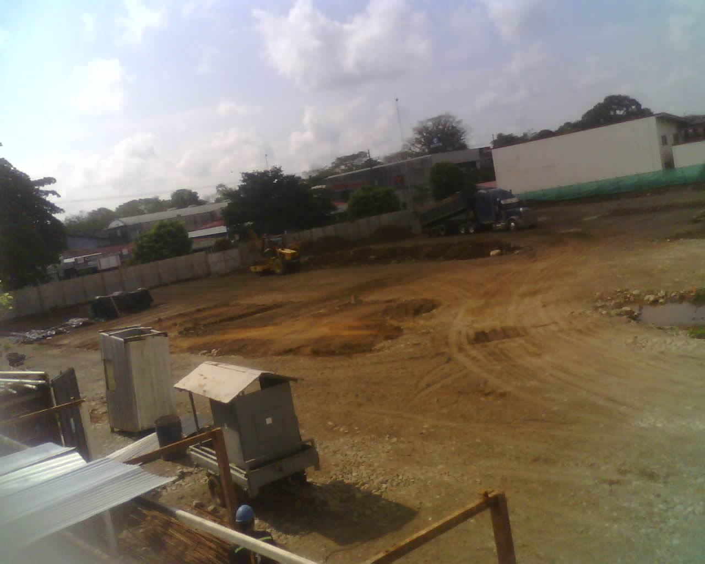

```js
import {Plot, grafico, fecha, fechaLarga, fechaTexto, hora, num, millones, plural, ESTADOS, escalaEstados, leyendaEstados, SENALES, alertasDe, razones, lamina, asegurarRayado, estiloPlot} from "./components/lupia.js";
asegurarRayado();
const senales = await FileAttachment("data/senales.csv").csv({typed: true});
const fichas = await FileAttachment("data/obras.csv").csv({typed: true});
const diario = await FileAttachment("data/estado_diario.csv").csv({typed: true});
const semanal = await FileAttachment("data/matriz_semanal.csv").csv({typed: true});
const serie = await FileAttachment("data/serie_avance.csv").csv({typed: true});
const eventos = await FileAttachment("data/eventos.csv").csv({typed: true});
const evidencia = await FileAttachment("data/evidencia.csv").csv({typed: true});
const resumen = await FileAttachment("data/resumen.json").json();
const porId = new Map(senales.map((d) => [d.obra_id, d]));
const fichaPorId = new Map(fichas.map((d) => [d.obra_id, d]));
const DIA = 864e5;
const corte = new Date(`${resumen.fecha_corte}T00:00:00Z`);
const inicioMonitoreo = d3.min(diario, (d) => d.fecha);
const finVentana = new Date(+corte + DIA);
```

```js
const pedida = new URLSearchParams(location.search).get("id");
const ordenadas = [...senales].sort((a, b) => a.prioridad - b.prioridad);
const selector = Inputs.select(ordenadas.map((d) => d.obra_id), {
  label: "Obra", value: porId.has(pedida) ? pedida : ordenadas[0].obra_id,
  format: (id) => `${id}. ${porId.get(id).nombre}`
});
const obraId = Generators.input(selector);
```

```js
history.replaceState(null, "", `?id=${obraId}`);
const o = porId.get(obraId);
const ficha = fichaPorId.get(obraId);
const dias = diario.filter((d) => d.obra_id === obraId);
const ultimas4 = dias.filter((d) => d.fecha > new Date(+corte - 28 * DIA));
const habiles4 = ultimas4.filter((d) => d.es_habil);
const ultimoActivo = d3.max(dias.filter((d) => d.estado === "actividad"), (d) => d.fecha);
const alertas = alertasDe(o);
// Días de la racha actual de inactividad (los mismos que cuenta la regla en Python)
const racha = [];
for (const d of [...dias].sort((a, b) => b.fecha - a.fecha)) {
  if (!d.es_habil || d.estado === "sin_datos") continue;
  if (d.estado === "actividad") break;
  racha.push(d);
}
const nSinDatos = dias.filter((d) => d.estado === "sin_datos").length;
const queSabemos = [
  `En las últimas 4 semanas hubo actividad en ${habiles4.filter((d) => d.estado === "actividad").length} de ${habiles4.length} días hábiles.`,
  ultimoActivo ? `El último día con actividad fue el ${fechaLarga(ultimoActivo)}.` : "No se observó actividad en el período.",
  `La cámara envió en promedio ${num(100 * d3.mean(ultimas4, (d) => d.cobertura), 0)} % de las fotos esperadas en esas 4 semanas.`,
  `La ejecutora reportó ${num(o.avance_reportado_pct)} % de avance al ${fechaLarga(o.fecha_ultimo_informe)}.`
];
const noSePuede = [
  "Si la obra avanza físicamente: la cámara mide presencia de personas y máquinas, no avance.",
  "Qué pasa fuera del ángulo de la cámara.",
  "Si hay una irregularidad: la señal solo indica dónde conviene revisar.",
  "El modelo detecta unas 85 de cada 100 personas visibles y se entrenó solo con imágenes de la Escuela de Pocosí.",
  ...(nSinDatos ? [nSinDatos === 1 ? "Lo ocurrido el día sin datos de la cámara." : `Lo ocurrido en los ${nSinDatos} días sin datos de la cámara.`] : [])
];
```

<div class="encabezado-seccion">
  <a class="volver" href="./index.html">Volver al orden de revisión</a>
  ${selector}
</div>

<section class="cajetin" aria-label="Datos de la obra y del contrato">
  <div class="titulo">${lamina(o.obra_id)}<h1>${o.nombre}</h1><span class="tenue">${o.tipo}, ${o.canton}</span></div>
  <div class="prioridad"><p class="etiqueta">Prioridad</p><p class="valor">${o.prioridad} de ${senales.length}</p></div>
  <div><p class="etiqueta">Institución ejecutora</p><p class="valor">${o.institucion_ejecutora}</p></div>
  <div><p class="etiqueta">Contratista</p><p class="valor">${o.contratista}</p></div>
  <div><p class="etiqueta">Monto vigente</p><p class="valor">${millones(o.monto_vigente_crc)}<small>${o.aumento_monto_pct > 0 ? `Original: ${millones(o.monto_original_crc)}, +${num(o.aumento_monto_pct)} %` : "Sin modificaciones"}</small></p></div>
  <div><p class="etiqueta">Plazo vigente</p><p class="valor">${fechaLarga(ficha.fecha_inicio)} al ${fechaLarga(o.fecha_fin_vigente)}<small>${o.fase === "terminada" ? "Obra terminada" : o.prorroga_reciente ? "Incluye una prórroga reciente" : "Plazo original"}</small></p></div>
</section>

<section class="veredicto" aria-labelledby="veredicto">
  <h2 id="veredicto">${o.en_cola_dispositivos ? "La cámara no envía datos" : alertas.length ? html`<span class="marca marca-trazo">Amerita revisión</span>` : o.fase === "terminada" ? "Obra terminada, sin alertas" : "Sin alertas"}</h2>
  <p class="tenue">${o.en_cola_dispositivos
    ? `Desde el ${fechaLarga(o.ultima_captura)} no llegan fotos (${plural(o.dias_sin_datos, "día", "días")}). Primero hay que reparar la cámara: mientras tanto no se puede concluir nada sobre la obra.`
    : `Puntaje de atención: ${Math.round(o.puntaje)} de 100.`}</p>
  ${alertas.length && !o.en_cola_dispositivos ? html`<ul class="razones">${razones(o).map((r) => html`<li class=${r.explicada ? "explicada" : ""}>${r.texto}</li>`)}</ul>` : ""}
  <div class="saber">
    <div><h3>Qué sabemos</h3><ul>${queSabemos.map((t) => html`<li>${t}</li>`)}</ul></div>
    <div><h3>Qué no se puede concluir</h3><ul>${noSePuede.map((t) => html`<li>${t}</li>`)}</ul></div>
  </div>
</section>

<nav class="pasos" aria-label="Pasos del análisis">
  <a href="#analizar"><b>1</b>Analizar</a>
  <a href="#contrastar"><b>2</b>Contrastar</a>
  <a href="#verificar"><b>3</b>Verificar</a>
  <a href="#documentar"><b>4</b>Documentar</a>
</nav>

```js
const CATEGORIA = {contrato: "Evento del contrato", ciudadania: "Reporte ciudadano", feriado: "Feriado"};
function lineaTiempo(width) {
  const datos = dias.map((d) => ({...d, estadoVista: ESTADOS[d.fase === "terminada" && d.estado !== "actividad" ? "terminada" : d.estado].label}));
  const ev = eventos.filter((e) => e.obra_id === obraId || e.obra_id === "*");
  const susp = dias.filter((d) => d.suspendido);
  const inicioRacha = racha.length >= 5 ? d3.min(racha, (d) => d.fecha) : null;
  return grafico({
    width, height: 176, marginLeft: width < 560 ? 64 : 112, marginTop: 24, marginRight: 8, style: estiloPlot,
    x: {type: "utc", domain: [inicioMonitoreo, finVentana], label: null, tickFormat: fecha, ticks: width < 560 ? 4 : 8},
    y: {domain: [0, 2.2], axis: null},
    color: escalaEstados(),
    symbol: {domain: Object.values(CATEGORIA), range: ["diamond2", "triangle2", "square2"], legend: true},
    marks: [
      inicioRacha ? Plot.rect([0], {x1: inicioRacha, x2: finVentana, y1: -0.1, y2: 2.1, fill: "var(--resaltador)", fillOpacity: 0.5}) : null,
      inicioRacha ? Plot.text([0], {x: finVentana, y: 2.2, text: () => `Racha sin actividad: ${plural(racha.length, "día hábil", "días hábiles")}`, textAnchor: "end", fill: "var(--tinta)", fontWeight: 600, dy: -4}) : null,
      Plot.rect(susp, {x1: "fecha", x2: (d) => new Date(+d.fecha + DIA), y1: 1.1, y2: 1.9, fill: "var(--niebla)"}),
      Plot.rect(datos, {
        x1: "fecha", x2: (d) => new Date(+d.fecha + 0.86 * DIA), y1: 0, y2: 1, fill: "estadoVista", stroke: "var(--trazo)", strokeWidth: 0.6,
        title: (d) => `${fechaLarga(d.fecha)}: ${d.estadoVista.toLowerCase()}\nLa cámara envió ${num(100 * d.cobertura, 0)} % de las fotos; ${num(100 * d.pct_actividad, 0)} % con actividad` +
          (d.explicacion ? `\nContexto: ${d.explicacion}` : ""), tip: true
      }),
      Plot.dot(datos.filter((d) => d.explicacion && d.estado === "sin_actividad"), {x: (d) => new Date(+d.fecha + 0.43 * DIA), y: 0.5, r: 2, fill: "var(--grafito)"}),
      Plot.dot(ev, {
        x: (d) => new Date(+d.fecha + 0.43 * DIA), y: 1.5, symbol: (d) => CATEGORIA[d.categoria], r: 6, stroke: "var(--tinta)", strokeWidth: 1.5, fill: "var(--papel)",
        title: (d) => `${fechaLarga(d.fecha)}. ${CATEGORIA[d.categoria]}\n${d.detalle}`, tip: true
      }),
      Plot.text([width < 560 ? "Días" : "Estado del día", "Eventos"], {x: inicioMonitoreo, y: [0.5, 1.5], text: (d) => d, textAnchor: "end", dx: -10, fill: "var(--grafito)"})
    ]
  });
}
function lluvia(width) {
  return grafico({
    width, height: 104, marginLeft: width < 560 ? 64 : 112, marginTop: 10, marginRight: 8, style: estiloPlot,
    x: {type: "utc", domain: [inicioMonitoreo, finVentana], label: null, tickFormat: fecha, ticks: width < 560 ? 4 : 8},
    y: {label: "Lluvia (mm)", labelArrow: "none", grid: true, ticks: 3},
    marks: [
      Plot.rectY(dias, {x1: "fecha", x2: (d) => new Date(+d.fecha + 0.78 * DIA), y: "lluvia_mm", fill: "var(--grafito)", fillOpacity: 0.55,
        title: (d) => `${fechaLarga(d.fecha)}: ${num(d.lluvia_mm)} mm`, tip: true}),
      Plot.ruleY([20], {stroke: "var(--tinta)", strokeDasharray: "3,3"}),
      Plot.text([20], {x: finVentana, y: 20, text: () => "Lluvia fuerte: 20 mm", textAnchor: "end", dy: -7, fill: "var(--tinta)", stroke: "var(--papel)", strokeWidth: 4, paintOrder: "stroke"})
    ]
  });
}
```

<section class="paso bloque" id="analizar" aria-labelledby="t-analizar">
  <h2 id="t-analizar"><span class="n">1</span>¿La alerta tiene explicación?</h2>
  <p>Cada día de las últimas 12 semanas, junto a los feriados, los eventos del contrato, los reportes ciudadanos y la lluvia.</p>
  ${leyendaEstados()}
  <figure aria-label="Estado de cada día y eventos de la obra">${resize((width) => lineaTiempo(width))}</figure>
  <figure aria-label="Lluvia diaria en la obra">${resize((width) => lluvia(width))}</figure>
  <p class="nota-tabla">La franja resaltada marca la racha actual de días hábiles sin actividad. El gris claro en la fila de eventos marca los días con suspensión aprobada, y un punto en un día vacío indica una explicación posible. Origen de la lluvia: ${resumen.origen_clima.join(", ")}.</p>
</section>

```js
const NOMBRES = {previsto: "Previsto", reportado: "Reportado", pagado: "Pagado"};
function contraste(width) {
  const s = serie.filter((d) => d.obra_id === obraId);
  const dominio = [ficha.fecha_inicio, d3.max(s, (d) => d.fecha)];
  const porSerie = (k) => s.filter((d) => d.serie === k).sort((a, b) => a.fecha - b.fecha);
  // Etiquetas al final de cada línea, separadas para que no se encimen
  const finales = ["previsto", "reportado", "pagado"].map((k) => ({...porSerie(k).filter((d) => d.fecha <= finVentana).at(-1), nombre: NOMBRES[k]}))
    .filter((d) => d.fecha).sort((a, b) => b.valor_pct - a.valor_pct);
  for (let i = 0; i < finales.length; i++) finales[i].y = i ? Math.min(finales[i].valor_pct, finales[i - 1].y - 7) : finales[i].valor_pct;
  const ultimo = porSerie("reportado").at(-1);
  return grafico({
    width, height: 300, marginLeft: 44, marginRight: 84, marginTop: 20, style: estiloPlot,
    x: {type: "utc", domain: dominio, label: null, tickFormat: fecha, ticks: width < 560 ? 4 : 8},
    y: {domain: [0, 100], label: "Avance o pago (% del contrato)", labelArrow: "up", grid: true},
    marks: [
      Plot.rect([0], {x1: inicioMonitoreo, x2: finVentana, y1: 0, y2: 100, fill: "var(--niebla)"}),
      Plot.text([0], {x: inicioMonitoreo, y: 100, text: () => "Período con cámara", dx: 6, dy: 10, textAnchor: "start", fill: "var(--grafito)"}),
      Plot.line(porSerie("previsto"), {x: "fecha", y: "valor_pct", stroke: "var(--trazo)", strokeWidth: 1.75, strokeDasharray: "5,4"}),
      Plot.line(porSerie("pagado"), {x: "fecha", y: "valor_pct", stroke: "var(--grafito)", strokeWidth: 1.5, curve: "step-after"}),
      Plot.line(porSerie("reportado"), {x: "fecha", y: "valor_pct", stroke: "var(--tinta)", strokeWidth: 2.25}),
      Plot.dot([...porSerie("reportado"), ...porSerie("pagado")], {x: "fecha", y: "valor_pct", r: 3.5, fill: (d) => (d.serie === "reportado" ? "var(--tinta)" : "var(--grafito)"), stroke: "var(--papel)",
        title: (d) => `${NOMBRES[d.serie]} al ${fechaLarga(d.fecha)}: ${num(d.valor_pct)} %`, tip: true}),
      Plot.text(finales, {x: "fecha", y: "y", text: "nombre", dx: 10, textAnchor: "start", fill: "var(--tinta)", fontWeight: 600}),
      ultimo && o.atraso_pts >= 5 ? Plot.link([0], {x1: ultimo.fecha, x2: ultimo.fecha, y1: ultimo.valor_pct, y2: o.avance_previsto_pct, stroke: "var(--tinta)", strokeWidth: 1.5, markerStart: "tick", markerEnd: "tick"}) : null,
      ultimo && o.atraso_pts >= 5 ? Plot.text([0], {x: ultimo.fecha, y: (ultimo.valor_pct + o.avance_previsto_pct) / 2, text: () => `${num(o.atraso_pts)} puntos de atraso`, dx: -10, textAnchor: "end", fill: "var(--tinta)", fontWeight: 600, stroke: "var(--papel)", strokeWidth: 4, paintOrder: "stroke"}) : null
    ]
  });
}
function franjaSemanas(width) {
  const s = serie.filter((d) => d.obra_id === obraId);
  const dominio = [ficha.fecha_inicio, d3.max(s, (d) => d.fecha)];
  const datos = semanal.filter((d) => d.obra_id === obraId).map((d) => ({...d, estado: ESTADOS[d.estado_semana].label}));
  return grafico({
    width, height: 46, marginLeft: 44, marginRight: 84, marginTop: 4, marginBottom: 6, style: estiloPlot,
    x: {type: "utc", domain: dominio, axis: null}, y: {axis: null}, color: escalaEstados(),
    marks: [
      Plot.rect(datos, {x1: "semana", x2: (d) => new Date(+d.semana + 6.2 * DIA), y1: 0, y2: 1, fill: "estado", stroke: "var(--trazo)", strokeWidth: 0.6,
        title: (d) => `Semana del ${fecha(d.semana)}: ${d.estado.toLowerCase()}`, tip: true}),
      Plot.text([0], {frameAnchor: "left", text: () => "Actividad observada por semana", dx: 0, fill: "var(--grafito)"})
    ]
  });
}
function comparacion(width) {
  const datos = senales.filter((d) => d.fase !== "terminada" && !d.en_cola_dispositivos);
  return grafico({
    width, height: 96, marginLeft: 12, marginRight: 12, style: estiloPlot,
    x: {domain: [0, 1], label: "Semanas con actividad observada", labelAnchor: "center", labelArrow: "none", tickFormat: (d) => `${num(100 * d, 0)} %`, grid: true},
    y: {axis: null},
    marks: [
      Plot.dot(datos, Plot.dodgeY({x: "proporcion_semanas_activas", r: 10, fill: (d) => (d.obra_id === obraId ? "var(--tinta)" : "var(--papel)"),
        stroke: (d) => (d.obra_id === obraId ? "var(--tinta)" : "var(--trazo)"), strokeWidth: 1.25,
        title: (d) => `${d.obra_id}. ${d.nombre}: ${num(100 * d.proporcion_semanas_activas, 0)} % de semanas con actividad`, tip: true})),
      Plot.text(datos, Plot.dodgeY({x: "proporcion_semanas_activas", r: 10, text: "obra_id", fill: (d) => (d.obra_id === obraId ? "var(--papel)" : "var(--tinta)"), fontWeight: 700, fontSize: 11}))
    ]
  });
}
```

<section class="paso bloque" id="contrastar" aria-labelledby="t-contrastar">
  <h2 id="t-contrastar"><span class="n">2</span>¿Lo reportado coincide con lo observado?</h2>
  <p>Avance previsto por el cronograma, avance reportado por la ejecutora y pagos, frente a la actividad que vio la cámara cada semana.</p>
  <figure aria-label="Avance previsto, reportado y pagado de la obra">${resize((width) => contraste(width))}</figure>
  <figure aria-label="Actividad observada por semana">${resize((width) => franjaSemanas(width))}</figure>
  <p class="nota-tabla">La actividad no mide el avance físico: sirve para detectar avances reportados que la cámara no respalda.</p>
  <h3 style="margin-top: 2rem;">Frente al resto de la cartera</h3>
  <figure aria-label="Proporción de semanas con actividad de cada obra">${resize((width) => comparacion(width))}</figure>
</section>

```js
const evObra = evidencia.filter((d) => d.obra_id === obraId);
const diasEvidencia = [...new Set(evObra.map((d) => String(d.fecha_hora).slice(0, 10)))].sort().reverse();
const estadoPorDia = new Map(dias.map((d) => [d.fecha.toISOString().slice(0, 10), d]));
const selectorDia = Inputs.select(diasEvidencia, {
  label: "Día",
  format: (d) => `${fechaLarga(d)}, ${ESTADOS[estadoPorDia.get(d)?.estado ?? "sin_datos"].label.toLowerCase()}`
});
const diaEvidencia = Generators.input(selectorDia);
```

```js
function marco(nombre, filas) {
  const esc = 0.25, W = 1280 * esc, H = 1024 * esc;
  const dets = filas.filter((d) => d.clase);
  const personas = dets.filter((d) => d.clase === "Persona").length;
  const maquinas = dets.length - personas;
  const lienzo = d3.create("svg").attr("viewBox", `0 0 ${W} ${H}`).attr("width", "100%").attr("role", "img")
    .attr("aria-label", `Foto de las ${hora(filas[0].fecha_hora)}: ${plural(personas, "persona", "personas")} y ${plural(maquinas, "máquina", "máquinas")}`);
  lienzo.append("rect").attr("x", 0.5).attr("y", 0.5).attr("width", W - 1).attr("height", H - 1).attr("rx", 4)
    .attr("fill", "var(--niebla)").attr("stroke", "var(--trazo)");
  lienzo.append("text").attr("x", W / 2).attr("y", H / 2).attr("text-anchor", "middle").attr("fill", "var(--grafito)")
    .attr("font-size", 12).text(dets.length ? "" : "Sin detecciones");
  for (const d of dets) {
    lienzo.append("rect").attr("x", d.x1 * esc).attr("y", d.y1 * esc).attr("width", (d.x2 - d.x1) * esc).attr("height", (d.y2 - d.y1) * esc)
      .attr("fill", "none").attr("stroke", "var(--tinta)").attr("stroke-width", 1.6)
      .attr("stroke-dasharray", d.clase === "Persona" ? null : "4,3")
      .append("title").text(`${d.clase}, probabilidad ${num(d.probabilidad, 2)}`);
  }
  return html`<figure>${lienzo.node()}<figcaption><b>${hora(filas[0].fecha_hora)}</b>: ${plural(personas, "persona", "personas")}, ${plural(maquinas, "máquina", "máquinas")}</figcaption></figure>`;
}
const imagenesDia = d3.groups(evObra.filter((d) => String(d.fecha_hora).startsWith(diaEvidencia)), (d) => d.nombre_imagen);
```

<section class="paso bloque" id="verificar" aria-labelledby="t-verificar">
  <h2 id="t-verificar"><span class="n">3</span>¿La evidencia sostiene la alerta?</h2>
  <p>Cuatro fotos del día, cerca de las 8, 10, 13 y 15 horas, con lo que detectó el modelo.</p>
  ${selectorDia}
  <div class="fotos">${imagenesDia.length ? imagenesDia.map(([nombre, filas]) => marco(nombre, filas)) : html`<p class="vacio">Ese día la cámara no envió fotos.</p>`}</div>
  <p class="nota-tabla">Línea continua: persona. Línea punteada: maquinaria. Pase el cursor por un recuadro para ver su probabilidad. Como las detecciones son simuladas, no hay fotos: se dibujan los recuadros del CSV sobre un marco de 1280 por 1024 píxeles.</p>
  <details>
    <summary>Ver una foto real de una cámara de dIAra</summary>
    
    <p class="nota-tabla">Imagen 20240319-085919.jpg del repositorio público de dIAra (CGR y Universidad CENFOTEC), piloto de 2024.</p>
  </details>
</section>

```js
const clave = `lupia-decision-${obraId}`;
let guardado = null;
try { guardado = JSON.parse(localStorage.getItem(clave) ?? "null"); } catch {}
guardado ??= {estado: "Nueva", motivo: "", nota: ""};
const formDecision = Inputs.form({
  estado: Inputs.radio(["Nueva", "En análisis", "Descartada", "Remitida"], {label: "Estado de la alerta", value: guardado.estado}),
  motivo: Inputs.select(["", "Feriado o lluvia", "Suspensión aprobada", "Falla de cámara", "Obra terminada", "Otro"], {label: "Motivo si se descarta", value: guardado.motivo}),
  nota: Inputs.textarea({label: "Nota del auditor", value: guardado.nota, rows: 3, width: 480, placeholder: "Qué revisó y qué concluyó"})
});
const decision = Generators.input(formDecision);
```

```js
try { localStorage.setItem(clave, JSON.stringify({...decision, actualizado: new Date().toISOString()})); } catch {}

function expedienteCSV() {
  const esc = (v) => `"${String(v ?? "").replaceAll('"', '""')}"`;
  const filas = [
    ["Expediente de LupIA (prototipo académico; detecciones simuladas)"],
    ["Fecha de corte", resumen.fecha_corte], ["Generado", new Date().toISOString()], [],
    ["Obra", `${o.obra_id}. ${o.nombre}`], ["Tipo", o.tipo], ["Cantón", o.canton],
    ["Institución ejecutora", o.institucion_ejecutora], ["Contratista", o.contratista],
    ["Monto vigente (CRC)", o.monto_vigente_crc], ["Fin vigente", o.fecha_fin_vigente], [],
    ["Puntaje de atención", o.puntaje], ["Prioridad", o.prioridad],
    ...SENALES.map((s) => [`Señal: ${s.label}`, o[`senal_${s.key}`], `peso ${resumen.pesos[s.key]}`]),
    ["Razones", razones(o).map((r) => r.texto).join(" | ")], [],
    ["Decisión del auditor", decision.estado], ["Motivo", decision.motivo], ["Nota", decision.nota], [],
    ["Fecha", "Estado del día", "Cobertura de la cámara", "Fotos con actividad", "Contexto"],
    ...dias.map((d) => [d.fecha.toISOString().slice(0, 10), ESTADOS[d.estado].label, d.cobertura, d.pct_actividad, d.explicacion]),
    [], ["Metodología", "Sin datos si llega menos del 50 % de las fotos; actividad si 15 % o más de las fotos laborales tienen detecciones. Detalle en la página Metodología de LupIA."]
  ];
  return filas.map((f) => f.map(esc).join(",")).join("\n");
}
function descargar() {
  const blob = new Blob(["" + expedienteCSV()], {type: "text/csv;charset=utf-8"});
  const a = document.createElement("a");
  a.href = URL.createObjectURL(blob);
  a.download = `expediente-obra-${obraId}-${resumen.fecha_corte}.csv`;
  a.click();
  URL.revokeObjectURL(a.href);
}
```

<section class="paso bloque registro" id="documentar" aria-labelledby="t-documentar">
  <h2 id="t-documentar"><span class="n">4</span>¿Qué decidió y con qué respaldo?</h2>
  <p>La decisión se guarda en este navegador. El expediente reúne datos, señales, decisión y el estado de cada día, y sirve como papel de trabajo.</p>
  ${formDecision}
  <div class="lupia-acciones no-imprimir">
    ${html`<button class="boton" type="button" onclick=${descargar}>Descargar expediente</button>`}
    ${html`<button class="boton secundario" type="button" onclick=${() => window.print()}>Imprimir o guardar en PDF</button>`}
  </div>
</section>
